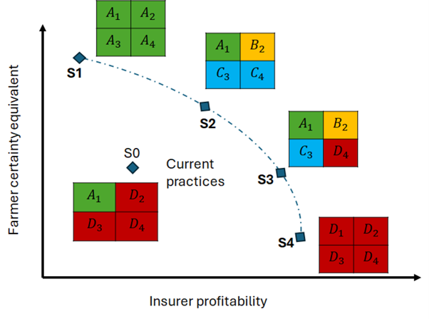

# BOLD-BCI
BOLD-BCI is a Bayesian Optimization and Learning Design for Next Generation Bundled Crop Insurance. The approach is used to optimize multiple objective for multiple agents.

## Landscape efficiency frontiers: Where to put bundled crop insurance?

## Acknowledgements
We acknowledge financial support from the People of the United States through US Government support to global food security. We also acknowledge support from the Sustainable Farming program of the CGIAR. All errors are our own. 
